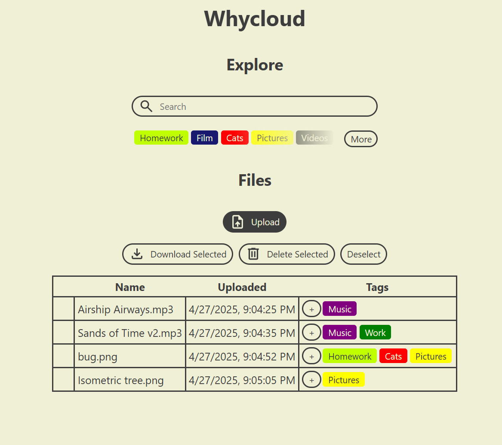

# Whycloud Prototype

Whycloud is a locally hosted cloud software, which uses tags for file managment.

## Features

* Uploading files
* Downloading files
* Viewing files
* Removing files
* Tagging files
* Filtering by name
* Filtering by tag

## Missing features

* At the moment you can't create or remove tags (without altering the server's folders. There is a fixed selection of tags to choose from
* There are still no icons for files
* Sorting of files
* Sorting of tags
